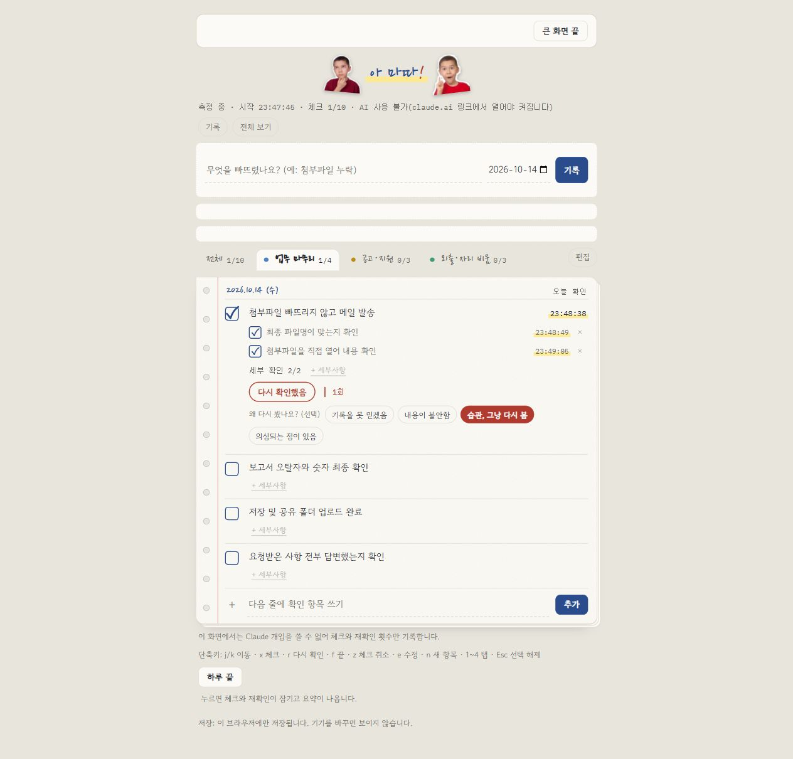
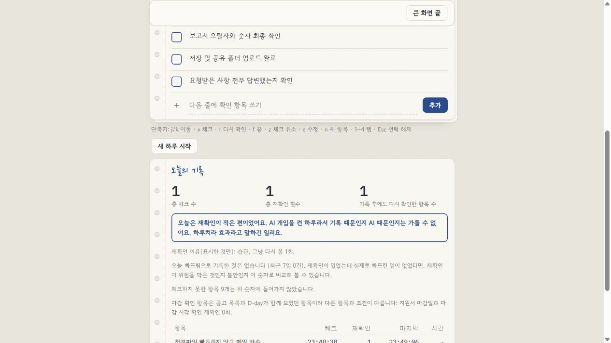

<div align="center">

# 아 마따!

**“분명 확인했는데, 또 확인하고 있네?”**<br>
확인한 순간을 남기고, 다시 확인하는 습관을 관찰하는 개인 기록 앱

`HTML · CSS · JavaScript` · `브라우저 저장` · `Claude Artifact 연동`

[화면과 기능](#화면으로-보는-사용-흐름) · [설계 의도](#설계에서-고민한-점) · [실행 방법](#실행-방법) · [상세 기획서](기획서_아마따_v1.md)

</div>



> 실제 앱을 일반 브라우저에서 실행한 화면입니다. 입력은 설명용 예시이며, 이 환경에서는 Claude 기능 없이 직접 기록합니다.

## 왜 만들었나요?

메일을 보내고 나서 첨부파일을 다시 열어 보고, 지원서를 제출한 뒤에도 접수 여부를 여러 번 확인하는 일이 있습니다. 완료 표시만으로는 **언제 무엇을 확인했는지**, **왜 다시 확인했는지**가 남지 않습니다.

아 마따!는 확인 시각과 재확인 행동을 기록해, **기록을 남겼을 때 재확인이 어떻게 달라지는지 살펴보려는 프로젝트**입니다. 재확인이 줄었다는 효과를 미리 주장하지 않고, 여러 날의 기록으로 확인하는 것을 목표로 삼았습니다.

| 대상 | 남기는 기록 | 하루가 끝나면 |
|---|---|---|
| 업무·지원·외출 준비를 반복 확인하는 개인 | 항목과 세부사항, 체크 시각, 재확인 횟수·이유 | 하루 요약을 보고 날짜별 기록을 비교 |

## 화면으로 보는 사용 흐름

### 01. 내 기준으로 확인하고, 다시 봤다면 기록하기

위 화면처럼 항목 아래에 **세부사항을 직접 입력**할 수 있습니다. 여러 줄을 붙여 넣으면 한 줄씩 확인 항목이 되고, 각각 체크하거나 삭제할 수 있습니다. 체크 시각은 항목 옆에 남습니다.

이미 확인한 항목의 `다시 확인했음`을 누르면 횟수를 기록하고, `습관, 그냥 다시 봄`처럼 이유를 선택할 수 있습니다. 업무 마무리·공고 지원·외출 준비 탭으로 상황을 나눠 봅니다.

### 02. 하루를 끝내고, 행동을 숫자로 돌아보기



`하루 끝`을 누르면 **총 체크 수 · 총 재확인 횟수 · 기록 후에도 다시 확인한 항목 수**를 모아 보여 줍니다. 확인하지 못한 항목은 따로 안내하고, 요약을 복사할 수 있습니다.

`기록`에서는 날짜별 표와 막대그래프로 흐름을 봅니다. Claude 환경에서는 AI 개입을 켠 날과 끈 날의 평균도 비교합니다. 화면의 “적은 편 / 많은 편”은 임의 기준에 따른 참고 문구이며, 행동 개선의 증거는 아닙니다.

## 주요 기능

| 기능 | 할 수 있는 일 |
|---|---|
| 직접 쓰는 체크리스트 | 항목 추가·편집·순서 변경, 세부사항 추가·체크·삭제 |
| 재확인 기록 | 횟수와 시각 저장, 선택형 이유 기록 |
| 하루 요약·여러 날 비교 | 날짜별 표·그래프, 개입 여부별 비교, 요약 복사 |
| 간단히 / 전체 보기 | 전체 보기에서 템플릿·빠뜨림 기록·큰 화면·시간 측정·단축키 사용 |
| AI 확인 기준 | 세부사항이 비어 있는 항목에 기준을 일괄 작성; 직접 쓴 내용은 유지 |
| Claude 보조 | 재확인 순간의 짧은 피드백, 사용자가 요청한 하루 분석 |
| 스크랩 공고 | 연동된 공고의 마감 임박 표시, 지원 상태와 제출 체크리스트 관리 |

## 설계에서 고민한 점

- **기록을 먼저, AI 호출은 나중에.** 재확인 횟수를 저장한 뒤 AI를 호출합니다. AI가 실패해도 행동 기록이 사라지지 않도록 했습니다.
- **AI의 영향을 구분하기.** 하루 단위로 개입을 끌 수 있습니다. 기록 자체와 AI 피드백의 영향을 구분해 살펴보기 위한 선택입니다.
- **익숙한 공책의 느낌.** 종이색, 링 바인더 구멍, 손글씨 탭, 체크 시각의 형광펜 표현으로 짧게 적고 확인하는 사용 방식에 맞췄습니다.
- **저장 범위를 드러내기.** Artifact 저장소가 있으면 본인 전용 경로에 저장하고, 없으면 이 브라우저에 저장합니다. 둘 다 사용할 수 없으면 메모리만 사용합니다.

## 실행 환경에 따라 달라지는 기능

| 기능 | 일반 브라우저 | 지원되는 Claude Artifact 환경 |
|---|---|---|
| 직접 입력·체크·재확인·하루 기록 | 가능 | 가능 |
| 저장 | 해당 브라우저 저장소 | Artifact `db` 사용 가능 시 계정 전용 경로 |
| AI 확인 기준·피드백·분석 | 사용 불가 | `window.claude`의 관련 기능이 제공될 때 가능 |
| 사람인 스크랩 공고 | 계정 저장소의 공고를 읽을 수 없음 | 공고 데이터가 별도로 갱신되어 있을 때 가능 |

공고 수집 예약 작업과 Claude 런타임은 이 HTML만으로 제공되지 않습니다. 앱이 별도의 로그인 서버나 자동 동기화 서버를 운영하는 구조는 아닙니다.

## 실행 방법

앱 파일은 [amatta.html](amatta.html) 하나입니다. Claude Artifact에 올리거나, HTML을 **UTF-8로 제공하는 정적 웹 서버**에서 열어 사용합니다. 일반 브라우저에서는 AI 없이 기본 기록 기능을 사용할 수 있습니다.

브라우저 자동 테스트는 다음과 같이 실행할 수 있습니다.

```bash
python -m http.server 5176
```

[http://localhost:5176/tests/index.html](http://localhost:5176/tests/index.html)에서 테스트 결과를 확인합니다. 이 테스트는 가짜 Claude 환경을 사용하므로 실제 AI 호출·동의 창·계정 저장까지 검증하는 것은 아닙니다.

## 구현 자료와 현재 한계

| 자료 | 내용 |
|---|---|
| [앱 코드](amatta.html) | 화면·스타일·기록 동작 |
| [브라우저 테스트](tests/index.html) | 저장과 AI 호출 순서, 직접 입력, 하루 요약, 공고·편집 동작 |
| [기획서](기획서_아마따_v1.md) | 초기 가설과 설계 결정, 12절의 현재 구현 범위 |
| [변경 기록](CHANGELOG.md) | 개선 과정 |

실제 업무에서 여러 날 사용한 효과는 아직 검증하지 않았습니다. 버튼을 누르지 않은 재확인은 기록되지 않으며, 현재의 날짜별 비교만으로 원인을 단정할 수 없습니다. 세부사항 글 수정·순서 변경, 확인 근거 입력, AI 제안 선택 미리보기 등 일부 개선안은 기획에만 남아 있습니다.

이 프로젝트는 [izzyma](https://github.com/huijae1234/izzyma-checklist)의 “빠뜨리지 않기”에서 출발해 **“확인한 뒤 다시 확인하는 행동을 이해하기”**로 관심을 확장했습니다. 생성형 AI와 함께 기획·구현·수정한 개인 학습 프로젝트입니다.
